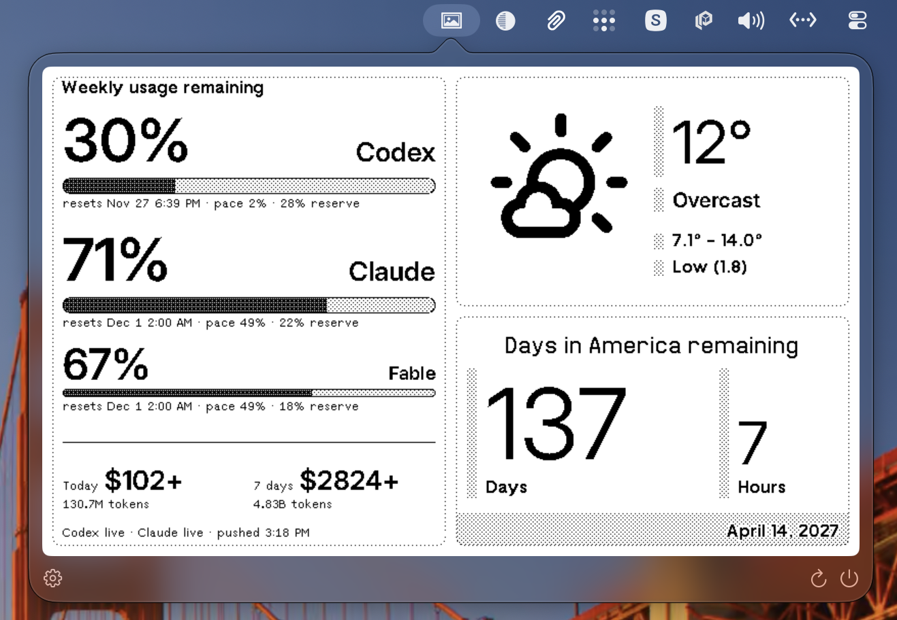
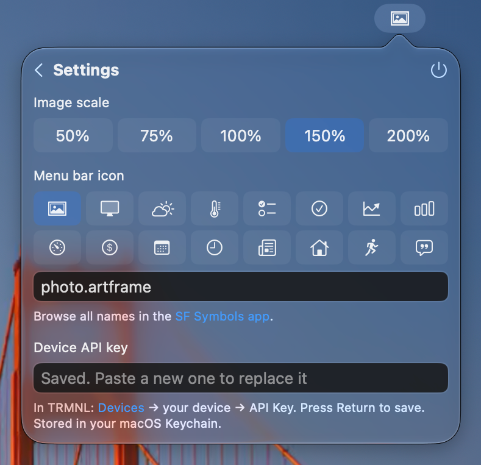

# TRMNL for the menu bar

A small macOS menu bar app that shows the screen your [TRMNL](https://trmnl.com) e-ink device is currently displaying. Click the icon and the current screen unfolds below it.

<p align="center">
  
</p>

- Shows exactly what your device shows, read from `GET /api/current_screen`, so it never advances your playlist.
- Refreshes every 5 minutes and each time you open it.
- Image scale from 50% to 200% (100% is pixel-sharp on Retina displays).
- Pick a menu bar icon that matches your playlist, or type any [SF Symbol](https://developer.apple.com/sf-symbols/) name.
- Your API key stays in the macOS Keychain.

<p align="center">
  
</p>

This is an unofficial, community-made app. It is not affiliated with or endorsed by TRMNL.

## Install

You need macOS 14 or later and Xcode (for `swiftc` and `actool`).

```bash
git clone https://github.com/jkrenge/trmnl-menubar.git
```

```bash
cd trmnl-menubar && make install
```

```bash
open /Applications/TRMNL.app
```

Click the icon in the menu bar and paste your device API key. You find it in TRMNL under [Devices](https://trmnl.com/devices) → your device → API Key.

## Develop

| Command | What it does |
|---|---|
| `make run` | Build and launch from the project folder |
| `make test` | Build and run the self-test |
| `make install` | Build and copy to `/Applications` |
| `make appstore` | Build a signed Mac App Store package |

Everything is in [TRMNL.swift](TRMNL.swift). There is no Xcode project: the [Makefile](Makefile) compiles a universal binary, builds the icon from [icon/make-icon.swift](icon/make-icon.swift) and signs the app.

### Signing

Without configuration the app is signed ad hoc, which is fine for running it on your own Mac. macOS then asks once after every rebuild whether the app may read your API key; choose "Always Allow".

To sign with your own Apple Developer team, create a `local.mk` next to the Makefile. It is gitignored.

```make
SIGN_IDENTITY = Apple Development: Your Name (XXXXXXXXXX)
TEAM_ID = YOURTEAMID
```

`security find-identity -v -p codesigning` lists the identities on your Mac.

### Mac App Store

`make appstore` also needs these in `local.mk`:

```make
APPSTORE_IDENTITY = 3rd Party Mac Developer Application: Your Name (YOURTEAMID)
INSTALLER_IDENTITY = 3rd Party Mac Developer Installer: Your Name (YOURTEAMID)
PROFILE = /path/to/Mac_App_Store.provisionprofile
```

Create both certificates in Xcode under Settings → Accounts → Manage Certificates, register the bundle ID and download a Mac App Store provisioning profile at [developer.apple.com](https://developer.apple.com/account/resources), then upload `build/TRMNL.pkg` with the Transporter app. If you publish your own build, change `BUNDLE_ID` in the Makefile and `CFBundleIdentifier` in [Info.plist](Info.plist) first.

## Privacy

The app talks only to `trmnl.com`: it sends your device API key to fetch the current screen and downloads that image. It collects no analytics and stores nothing outside your Mac. The API key is kept in your macOS Keychain, and your settings in the app's sandboxed preferences.

## Contributing

Issues and pull requests are welcome. See [CONTRIBUTING.md](CONTRIBUTING.md).

## License

[MIT](LICENSE)
